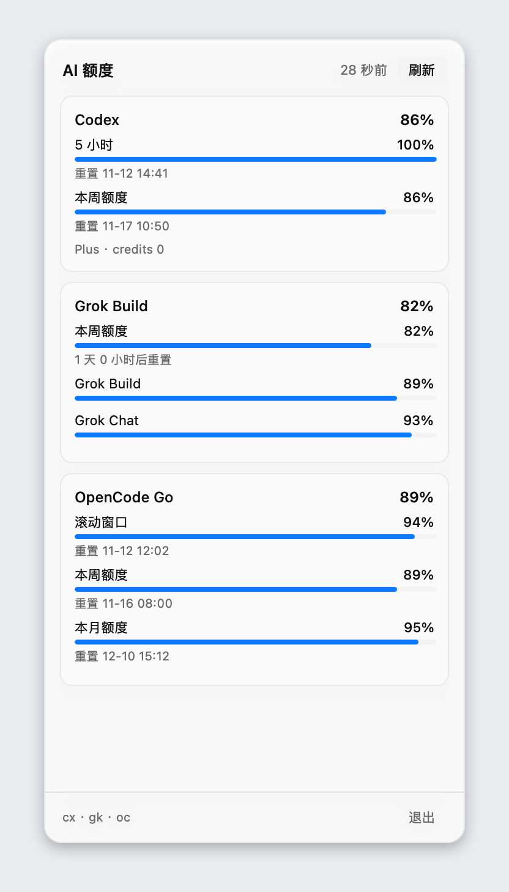
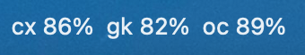

# Quota Bar

**Your AI quotas, at a glance.**

[](LICENSE)


Quota Bar is a menu bar app for macOS and a tray app for Linux that shows how
much quota your local AI CLIs have left — Antigravity, Claude Code, Codex, Grok
Build, Grok Bot and OpenCode Go. One tray item, one popup panel, no web view
and no JavaScript runtime. Written in Rust with [NSH](https://nsh.dev).



The macOS menu bar item is text only, two compact lines: the 5-hour (or
rolling) window of every enabled provider above its weekly window. Providers
without a 5-hour window show `-` on the top line:



Six dashboards is five too many. Quota Bar reads the CLIs you already have
signed in, keeps the numbers in memory, and stays out of the way.

## Why it feels good

- **One glance, no navigation.** The tray title shows the 5-hour and weekly
  windows side by side in two lines. Click it for every window and reset time.
- **Native, not a dashboard.** Rust, AppKit on macOS, GTK 4 on Linux. No web
  view, no Electron, no JavaScript runtime.
- **Close to free when idle.** One timer, no polling loop, no window while the
  panel is closed. An idle app sleeps at 0% CPU.
- **Honest colors.** Blue is healthy, bars turn amber below 40%, and anything
  below 15% turns red — including the number itself.
- **Yours to trim.** Show only the providers you use; the choice is saved and
  hidden providers are never fetched.

## Providers

| Tool | Menu bar | How Quota Bar reads it |
| --- | --- | --- |
| Antigravity | `ag` | `agy -p "/quota" --output-format json`, plus `/credits` for the balance |
| Claude Code | `cc` | `claude -p "/usage" --output-format json`; remaining = 100 − used |
| Codex | `cx` | ChatGPT's usage endpoint with the login in `~/.codex/auth.json`; a stale login is refreshed by `codex app-server`, without a model turn |
| Grok Build | `gk` | Grok's billing endpoint with the OIDC login in `~/.grok/auth.json`; an expired token is refreshed and written back |
| Grok Bot | `gb` | Cursor's dashboard with the login in Cursor's `state.vscdb`; read-only |
| OpenCode Go | `oc` | `GET /v1/usage` with the stored `oc_sk_…` key |

Each provider is optional. If its CLI is missing or signed out, its card says
so, and the other providers keep working. See
[docs/providers.md](docs/providers.md) for setup details and overrides.

## Install

From source — one command to try it:

```sh
git clone https://github.com/tdawn0-0/quota-bar.git
cd quota-bar
cargo run
```

Build a signed macOS app bundle:

```sh
nsh package --target macos --run
```

The packaged app is a menu bar app (`macos.activationPolicy: accessory`), so it
has no Dock icon. Add it under System Settings → General → Login Items to start
it at login.

### Linux

The Linux backend uses GTK 4, GStreamer and Pango. On Debian or Ubuntu:

```sh
sudo apt install build-essential pkg-config libgtk-4-dev \
  libgstreamer1.0-dev libgstreamer-plugins-base1.0-dev \
  libpango1.0-dev libcairo2-dev libgdk-pixbuf-2.0-dev libglib2.0-dev \
  libxkbcommon-dev libwayland-dev libx11-dev libxi-dev libxcursor-dev sqlite3
cargo run
```

You also need a StatusNotifierItem host. KDE, Xfce and most desktops have one;
GNOME needs the AppIndicator extension
(`gnome-shell-extension-appindicator`). Install `fonts-noto-cjk` if the
panel's Chinese labels show as boxes.

Windows is not supported.

## Configuration

Each provider can be shown or hidden from the tray's **显示** submenu. The
choice is saved to `config.json` in the app's data directory:

```
~/Library/Application Support/bar.jyeu.quota/config.json   # macOS
$XDG_DATA_HOME/bar.jyeu.quota/config.json                  # Linux
```

`QUOTA_BAR_CONFIG` overrides the path. Every provider is on unless its entry
says otherwise, so a missing file shows everything and a provider added later
starts enabled:

```json
{
  "providers": {
    "antigravity": true,
    "claude": true,
    "codex": true,
    "grok": true,
    "grokbot": true,
    "opencode": false
  }
}
```

An entry can also be an object, leaving room for provider settings later:

```json
"claude": { "enabled": false }
```

Edits take effect on the next refresh. Hidden providers are neither fetched nor
shown.

## How it refreshes

Data is fetched at launch, every five minutes, with the **刷新** button, or
from the tray's **刷新** item. Opening the panel never fetches: it shows the
numbers already in memory, so it opens instantly.

Batches run concurrently and each source lands as soon as it answers, so one
slow CLI never holds up the rest. If a source fails, its card shows the error
and keeps the last numbers it had.

## Development

```sh
cargo test
cargo build --release
```

Debug switches for development and screenshots:

| Variable | Effect |
| --- | --- |
| `QUOTA_BAR_OPEN_PANEL=1` | Open the panel at launch |
| `QUOTA_BAR_PIN_PANEL=1` | Keep the panel open while you take screenshots |
| `QUOTA_BAR_OPEN_DELAY_MS=30000` | Wait before opening the panel (let the first fetch land) |
| `QUOTA_BAR_PANEL_AT=x,y` | Place the panel (macOS) |
| `QUOTA_BAR_REFRESH_SECS=15` | Faster refresh while testing (minimum 5) |
| `QUOTA_BAR_CONFIG=path` | Use another config file |

More in [docs/development.md](docs/development.md).

## Documentation

- [The panel](docs/panel.md) — what every part of the popup does
- [Providers](docs/providers.md) — accounts, endpoints and overrides
- [Development](docs/development.md) — build, debug and screenshot

## A note on the endpoints

Codex, Grok Build, Grok Bot and OpenCode Go are read through the same internal
endpoints their own clients use, not public APIs, so they may change. Quota Bar
never starts a model turn, never uploads your data, and only refreshes a login
when the stored one has expired. Cursor's database is opened read-only.

## Layout

```
src/lib.rs        tray item, popup panel, refresh policy
src/config.rs     which providers are on, saved to config.json
src/quota.rs      the providers, one collector each, parsing and formatting
src/main.rs       cargo run entry (AppKit / GTK 4 backend)
nsh.json          app metadata, accessory policy, hidden main window
docs/             screenshots and guides
```

## License

MIT. See [LICENSE](LICENSE).
