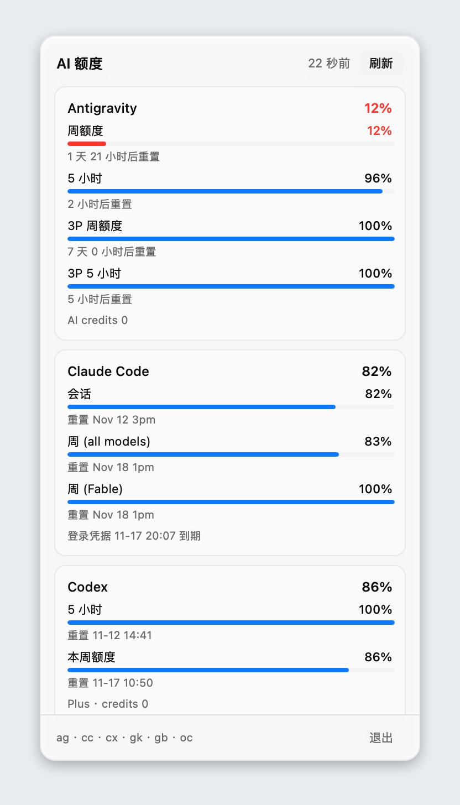

# The panel

The panel is a 344 pt wide popup that opens under the menu bar item on macOS
(and from the tray menu on Linux). It is a translucent sheet with a hairline
top edge, a fixed header and footer, and a scrolling list of provider cards.
The labels are in Chinese because the numbers are read at a glance.

The screenshot above has all six providers enabled, scrolled to the top; the
list continues below the window and scrolls.

## Anatomy

**Header.** The title, how long ago the data was refreshed (`22 秒前`, or
`未刷新` before the first fetch), and the **刷新** button, which reads
**刷新中** while a batch is running.

**Cards.** One card per enabled provider, in a fixed order:

| Menu bar | Card |
| --- | --- |
| `ag` | Antigravity |
| `cc` | Claude Code |
| `cx` | Codex |
| `gk` | Grok Build |
| `gb` | Grok Bot |
| `oc` | OpenCode Go |

The large percentage on the right is the provider's tightest window — the one
that will run out first. Below it, each quota window gets a label, its own
percentage, a progress bar, and a reset time said in words (`1 天 21 小时后重置`,
`重置 11-16 08:00`, `当前不适用`). A final line carries credits or the expiry of
the login. When a fetch fails, the card shows the error in red and keeps the
last numbers it had.

**Footer.** The enabled provider shortcuts (`ag · cc · cx · gk · gb · oc`) and
**退出**.

## Color

| Remaining | Bar | Percentage |
| --- | --- | --- |
| 40–100% | Blue | Normal text |
| 15–39% | Amber | Normal text |
| 0–14% | Red | Red |
| Not applicable | Muted | Muted |

In the screenshot, Antigravity's weekly window is at 12% and reads red;
everything else is healthy blue.

## Size and scrolling

The window is sized for one 184 pt row per enabled provider, plus 104 pt of
chrome, clamped to 220–656 pt. With three or more providers it is 656 pt tall;
content that does not fit scrolls inside the sheet while the header and footer
stay put. This keeps the panel from growing past a comfortable height on a
laptop screen.

## Behaviour

- Opening the panel never fetches. It shows what is already in memory, so it
  appears instantly.
- On macOS, a second click on the tray item, a click in another app, or Escape
  closes it; the window's memory is released. Under GNOME, the tray label opens
  a menu and its **面板** item opens the panel.
- Data refreshes at launch, every five minutes, with the **刷新** button, or
  from the tray's **刷新** item. A provider turned back on refreshes right away.
- `QUOTA_BAR_PIN_PANEL=1` keeps the panel open for screenshots; otherwise it
  closes on blur.
